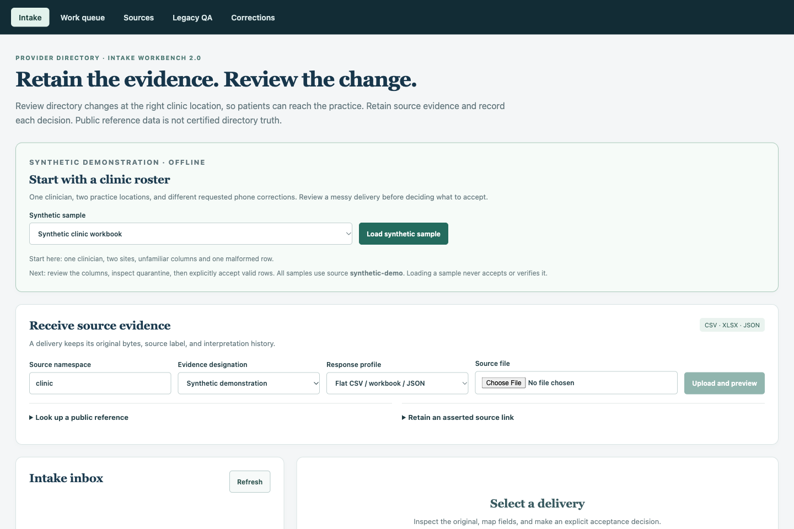

# Provider Directory Intake Workbench 2.0

A local Python/FastAPI, React/TypeScript, and SQLite application for receiving heterogeneous provider-directory evidence and working location-specific corrections through human verification.

Upload a CSV or XLSX, map unfamiliar headers, inspect quarantined rows, explicitly accept valid observations, and retain the original file and interpretation history. Saved JSON, bounded NPPES lookups, and CMS Doctors and Clinicians pages use the same receipt and acceptance service. Repeated deliveries preserve ownership, initial evidence, and workflow history.

The engineering focus is a practical data-operations workflow: receive external records, validate and store them with provenance, review changes, retain decision history, and produce reproducible handoffs. Python, SQL/SQLite and the web interface support that complete workflow.

Public observations are reference evidence, not certified provider truth. The offline clinic/payer demonstration is synthetic. Submission references and verification observations are manually asserted; the application sends no payer updates.



## Quick start

Requires Python 3.10+ and Node 22.12+ (or a supported newer even-numbered release); qualification used Python 3.13 and Node 22. Install dependencies once:

```bash
python3 -m venv .venv
source .venv/bin/activate
python3 -m pip install -e '.[dev]'
npm ci --prefix web
make workbench
```

Open **http://127.0.0.1:5173/?view=intake**. Choose **Synthetic clinic workbook → Load synthetic sample**. Header row 2 is selected; **Use suggested columns** fills an editable form. Review it, save mapping, inspect **2 valid / 1 quarantined**, then enter a reviewer/reason to accept. One clinician has separate NORTH and SOUTH phone requests.

The launcher explicitly enables `PDTL_DEMO=1`, prints its fresh `.runtime/employer-demo-*` directory, and creates synthetic inputs in its `inputs/` folder. The picker also offers a canonical CSV, changed delivery and saved NPPES/CMS examples. All picker receipts use `synthetic-demo`; normal uploads keep their chosen namespace/designation. Sample loading never accepts or verifies data. Direct service startup leaves sample loading disabled unless explicitly enabled. No account or network is needed after dependencies are installed. The launcher fails clearly if a required port is occupied or either service exits unexpectedly; it stops its own service groups and retains storage. Ctrl-C stops both services and retains the demo. Resume it with:

```bash
PYTHONPATH=src python3 scripts/demo.py --root .runtime/employer-demo-REPLACE_ME
```

Follow the [five-minute demonstration](docs/operations_governance/sop_provider_remediation.md). See the [case study](docs/CASE_STUDY.md) and [qualification evidence](docs/evidence/intake_2_0/README.md).

## Operator workflow

- **Intake:** CSV/XLSX/saved JSON, explicit encoding/delimiter, worksheet/header selection, mapping attempts, full bounded validation counts, retained originals, quarantine CSV and evidence packet JSON. An invalid import remains a visible receipt and can be reprocessed or rejected.
- **Work queue:** distinct QA dispositions and correction verification; location scope, explained risk, ownership, needs information, follow-up, URL-backed filters, stale-version conflict recovery, and immutable initial evidence alongside later observations.
- **Handoff:** download all durable work or the selected case as XLSX. The all-work download ignores UI filters and includes every durable case, linked observation and decision; the selected-case download limits case/evidence/history scope. Shared receipt previews can contain other rows. These are read-only snapshots, separate from the legacy pipeline workbook. See the [workbook contract](docs/DATA_DICTIONARY.md#durable-work-handoff-workbook).
- **Sources:** bounded lookup scope, metadata, retrieval/update/publication dates, last retrieval success/failure, and honest truncation. An asserted evidence link remains unfetched.
- **Legacy QA / Corrections:** preserved earlier pipeline workflows. These compatibility views still use generated current-batch QA evidence and the original correction snapshots. New intake work lives in the durable Work queue.

One NPI can represent several operating locations. Supplied source location keys scope file observations within that source. Public observations without that scope need an explicit relationship. When a native record contains multiple addresses, select the particular practice address; mailing evidence cannot establish an operating location. No provider records are merged automatically.

## Storage and identity

```text
receipt → hashed original artifact → versioned processing attempt
                                  → native source observations → cases and later evidence
                                                               → accountable events
```

A hash identifies bytes, a receipt identifies a delivery, and a native provider/location/listing key identifies operational scope. Row numbers are evidence locators. Reordered deliveries preserve scoped work; missing native identities stay unresolved. Later evidence never automatically verifies, closes, or reopens work. Missing from a bounded delivery never implies termination.

`PDTL_ROOT` owns `directory.sqlite3`, `artifacts/`, `exports/`, and recovery metadata. Direct Python services default to `.runtime/local`; Make's legacy demo/service targets default to `.runtime/demo`. `PDTL_DB` optionally selects the database explicitly; retain its matching artifact root. CLI `--sqlite`/`--output-dir` override their individual paths. The unified service is:

```bash
PDTL_ROOT=.runtime/my-work PYTHONPATH=src python3 -m provider_directory_truth_layer.intake_api
```

Service startup never runs the pipeline or deletes data. `make demo` explicitly refreshes only the legacy synthetic projection in its demo root. `make validate` creates an invocation-owned fixture root. `make clean` deletes nothing. Playwright creates its own temporary database and uses known ports 8100/5180 without server reuse.

Schema migrations 1–3 are additive, transactional, and reject unknown future versions. Legacy upgrade backups are created with SQLite's backup API. Existing source/runtime originals are not automatically migrated. New intake event rows have database update/delete guards and expected-version checks. Per-connection foreign keys, WAL, and a 10-second busy timeout are configured. Direct database editing is outside the application trust boundary.

On restart, unfinished processing attempts become `interrupted`; reprocess the retained receipt. `artifact-recovery.json` reports staged, unregistered, or missing artifacts without deleting or accepting them. Accepted observations and linked work commit together. Export files are projections, not the database of record.

## Supported inputs and limits

| Input | Contract |
| --- | --- |
| CSV | UTF-8/BOM or CP1252; comma, semicolon, tab, pipe; explicit unique headers and mapping. |
| XLSX | Selected worksheet/header row 1–100; original cell coordinates/types/formats retained; formulas quarantined and never executed. Text and simple zero-formatted numeric identifiers preserve leading zeroes. |
| Flat JSON | Array of record objects, explicitly selected `flat` profile. |
| NPPES JSON/API | Entity-native record and all supplied addresses/taxonomies; exact NPI or bounded search. |
| CMS JSON/API | Clinician/enrollment/group/address grain; metadata for `mj5m-pzi6`; no NPI deduplication. |
| Evidence link | Title, source, URL and asserted observation time; no arbitrary fetching or scraping. |

Artifact limit: 10 MiB; tabular row limit: 20,000. Interactive evidence samples contain up to 50 observations; queue rendering shows up to 200 matching items, with client-side search over loaded summaries. Full quarantine and packet downloads retain all rows/history. Parsing/acceptance are bounded requests in worker threads with persisted attempts, not a distributed background queue. Slow imports display a busy state and remain recoverable after interruption.

On the qualification machine, a synthetic 20,000-row CSV preview took 1.14 seconds and acceptance 9.86 seconds at about 312 MiB peak process RSS. This does not establish equivalent XLSX or multi-writer performance. Reproduce with `PYTHONPATH=src python3 scripts/benchmark_intake.py 20000`.

## Checks

The 2026-10-23 G0–G5 baseline passed 103 Python tests, three frontend tests and 12 browser scenarios. The employer-readiness follow-up adds guided samples and XLSX handoff coverage; see the [dated follow-up evidence](docs/evidence/employer_readiness/README.md) for screenshots and restart rehearsal, and the [subsequent hardening checks](docs/evidence/employer_readiness/hardening/README.md) for 124 Python tests, six frontend tests and 14 browser scenarios. Pipeline validation and production build remain required.

```bash
make validate
python3 -m pytest -q
npm test --prefix web
npm run build --prefix web
cd web && npx playwright install chromium && cd ..
npm run test:e2e --prefix web
git diff --check
```

CI includes isolated browser tests and retained failure traces. Network calls remain separate from deterministic checks. `make validate-public` tests the compatibility sample downloader with isolated storage; it is not the durable adapter demonstration.

## Operational SQL

Run read-only questions against an existing durable intake database: follow-up cases, original receipt/row lineage, deterministic latest events, and differences between two selected accepted deliveries. The [query guide](docs/OPERATIONAL_SQL.md) declares result grain, parameters, synthetic outputs and limits.

```bash
PYTHONPATH=src python3 -m provider_directory_truth_layer.operations_sql --db .runtime/my-work/directory.sqlite3 follow-up --as-of 2026-10-30
```

## Recurring clinic files

After reviewing a ready file, expand recurring import review and save a named mapping revision. Upload changed bytes in the same source scope, select the saved revision, and apply it. Inspect the single accepted baseline, old/new fields, blocked-invalid rows and missing records before accepting. Missing required headers pause acceptance; unknown columns remain in the original. If another delivery is accepted first, refresh comparison and review again. See [API](docs/API_REFERENCE.md#recurring-file-intake-schema-v3) and [workflow](docs/OPERATIONS_WORKFLOW.md#recurring-clinic-deliveries).

## Planned next phase

The [near-term delivery plan](docs/INTAKE_2_0_PROPOSAL.md#near-term-delivery-priority-publishable-core-and-transferable-data-work) prioritizes the current core as a reviewed publication candidate, the implemented operational SQL pack and recurring clinic imports. [Organization/network participation storage](docs/INTAKE_2_0_PROPOSAL.md#proposed-next-phase-recurring-organization-and-network-rosters) follows that checkpoint. These are planned deliverables, not newly implemented or published capabilities. Clinics/health systems remain organizations; payer-network participation is a separate source-asserted relationship.

The [delivery checkpoints](docs/INTAKE_2_0_PROPOSAL.md#delivery-checkpoints-and-documentation-updates) specify the additions, documentation and acceptance evidence for each PR. Feature claims follow verified behavior; GitHub publication status is tracked separately from local qualification.

## Contributor references

- [Project state](PROJECT_STATE.md), [working agreement](AGENTS.md), [execution checkpoint](docs/INTAKE_2_0_PROGRESS.md)
- [API](docs/API_REFERENCE.md), [data dictionary](docs/DATA_DICTIONARY.md), [architecture decisions](docs/DECISIONS.md)
- [Public sources](docs/PUBLIC_DATA_SOURCES.md), [operations workflow](docs/OPERATIONS_WORKFLOW.md)
- [Accepted proposal](docs/INTAKE_2_0_PROPOSAL.md), [dated baseline review](docs/INTAKE_2_0_REVIEW.md)

Authentication, multitenancy, deployment, payer writeback, automatic identity merging, bulk case operations, national replication, KPI integration, and experimental FHIR are outside this implementation. Local reviewer names are assertions. The compatibility batch pipeline retains its earlier provider-level comparison limits; use the location-aware intake workflow for multi-location operational review.
