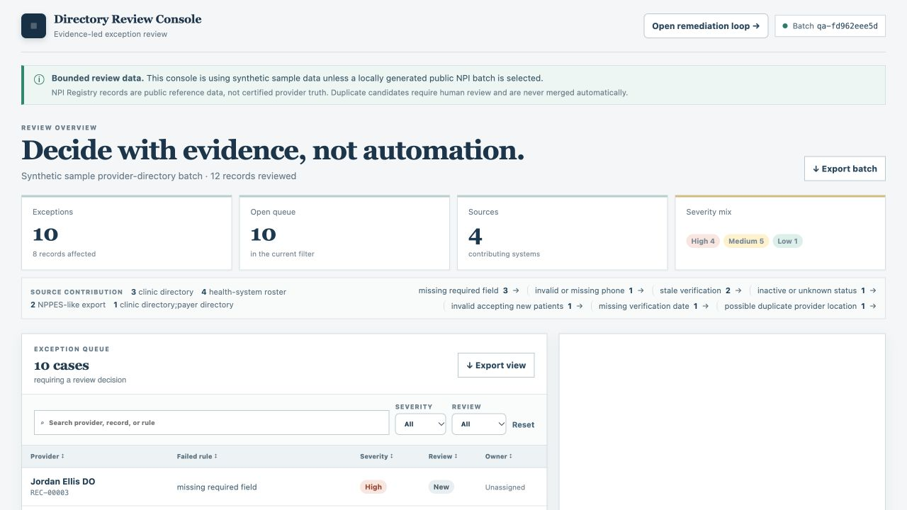
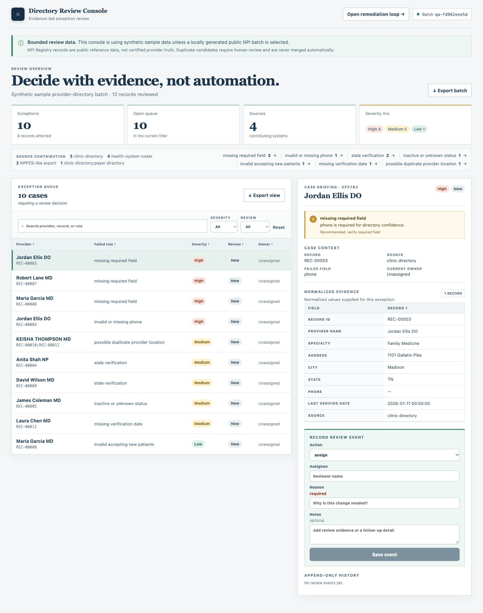
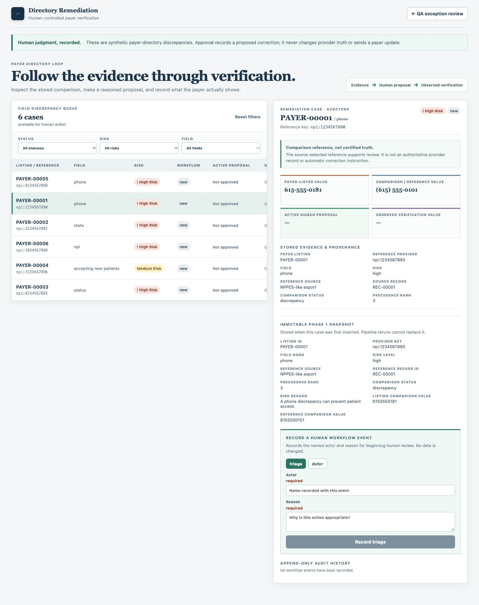

# Provider Directory 2.0: Current-State Review

Reviewed 2026-10-23 against `main` at `cad9765` in `provider-directory-truth-layer`.

This review supports the proposed intake workbench. It is not a 2.0 implementation or production qualification.

## Findings that determine the build order

1. The review/remediation core is worth preserving: stable remediation identity, immutable initial evidence, required transition inputs, proposal/submission/verification separation, and audit history.
2. Intake currently means reading one schema-shaped CSV; there is no operator receipt, import mapping/acceptance journey, or durable observation history.
3. A synthetic in-memory reproduction confirmed data-fidelity loss: a blank NPI became `"nan"`, ZIP `02108` became `2108`, and QA produced zero exceptions. See [the reproduction receipt](evidence/intake-fidelity-reproduction-2026-10-23.json).
4. General QA case identity is batch/index based and detail relies on current evidence. Retaining a review event alone does not make previous source evidence retrievable after a changed batch.
5. Provider-level source selection needs explicit location scope before accepting multiple legitimate locations. Cross-location mixing is a source-derived risk; it was not reproduced as a current runtime incident.
6. NPI source-update dates are currently labeled verification dates. Preserve the source timestamp meaning in the new adapter.
7. At baseline, governance, API, and architecture documents contained unsupported implementation claims. The documentation handoff corrects those descriptions; application gaps remain open.

## Fresh checks

| Check | Result and scope |
| --- | --- |
| Python | `python3 -m pytest -q -p no:cacheprovider`: 31 passed in 5.96 seconds. |
| Frontend | `npm test -- --reporter=dot`: two tests in two files passed. |
| Production build | `npm run build`: TypeScript and Vite succeeded. |
| Synthetic pipeline | Separate temporary SQLite/output directory: 12 normalized records, 10 QA exceptions, six remediation discrepancies. |
| UI | Manual inspection of queue, case detail, and remediation detail using the isolated database. No review decisions were submitted. |
| Browser E2E | Existing test definitions inspected; suite not rerun because its default startup cleans runtime storage. API workflow scenarios are covered by the fresh Python suite. |

An initial isolated remediation-server launch used the wrong application-factory name. It was corrected to `create_remediation_app`; the subsequent loaded remediation view is the accepted evidence below. That setup error is not a product defect.

## Current-flow screenshots and assessment

All screenshots were captured and inspected in this review using the in-app browser. They show the existing product, not proposed 2.0 screens. The viewport was 1280 by 720; detail captures include full-page content.

### 1. Open the QA queue — functional downstream entry

The queue presents source contribution, severity, search/status controls, and selectable cases. The large overview occupies most of the initial viewport. There is no intake entry in this surface; source inspection confirms there is no upload/receipt flow elsewhere in the current frontend.



### 2. Inspect a QA case — useful evidence, long decision path

The selected row and case panel show failed field, source, normalized record, assignment/reason controls, and history. The form's required inputs and disabled save state are visible. File receipt and original source-row lineage are absent. The desktop layout requires scrolling to reach the action/history section.



### 3. Inspect a payer discrepancy — strong reusable correction model

The current view distinguishes payer-listed, reference, proposal, and observed values and preserves initial comparison evidence. The queue does not expose intake receipt, location scope, ownership, or follow-up. Technical labels such as “Immutable Phase 1 snapshot” can become ordinary operator wording, with implementation detail in a disclosure.



## Accessibility and verification limits

Observed accessibility text exposes named filters and case rows, headings, required form fields, and disabled actions. These are useful foundations. Compact text/badges, row focus, long evidence panels, narrow layouts, validation announcements, and error recovery require dedicated checks during implementation. Screenshots alone do not establish contrast ratios or assistive-technology behavior. This pass did not perform a screen-reader, full keyboard, mobile, contrast, or end-to-end correction audit.

## Public-source feasibility

A delegated read-only research pass verified bounded HTTP-200 reads on 2026-10-23 from NPPES Registry, CMS Doctors and Clinicians, and CMS National Provider Directory FHIR metadata/Practitioner/Location resources. A filtered CMS state query timed out. These results support adapter feasibility, not implemented integrations or reliable full-dataset availability. Source URLs, scopes, and limits are recorded in the repository proposal.

## Review ownership

Three bounded read-only agent reviews covered intake architecture, external public sources, and operator workflow suitability. The primary review reconciled their findings with current source, independently reproduced the fidelity issue, ran baseline checks, inspected the UI, and authored the canonical proposal.

The next implementation milestone is Slice 0 followed by the complete CSV/XLSX intake journey in Slice 1 of `docs/INTAKE_2_0_PROPOSAL.md`.


## Detailed findings and dispositions

| ID | Finding and evidence | Baseline evidence class | Disposition |
| --- | --- | --- | --- |
| R01 | CSV inference plus string conversion changes blank NPI and leading-zero ZIP; `pipeline.py:23`, `normalize.py:66-73`, `qa.py:65-75`. | Independently reproduced in memory. | Open; G0 regression and fidelity fix. |
| R02 | One schema-shaped CSV is the main input; `pipeline.py:23`. Missing columns become blanks during normalization. | Source verified. | Open; G1 explicit contracts, preview, quarantine. |
| R03 | Generated evidence tables replace current contents; `export.py:83-108`. There is no retained raw-response/artifact ledger. | Source verified. | Open; G1 durable storage and versioned interpretations. |
| R04 | QA IDs include batch/index and old detail requires current exceptions; `review_api.py:167-179,282-295`. | Source verified; no fabricated data-loss incident claimed. | Open; G3 stable work and retained evidence. |
| R05 | NPI records use positional IDs, flatten one address/taxonomy, map source update to verification, and map unrecognized status to inactive; `npi_api.py:65-113`. | Source verified. | Open; G0 date semantics, G2 native-grain adapter. |
| R06 | Reference selection groups by provider and independently selects fields; `remediation.py:161-166,311-324,337-341`. | Inferred multi-location risk from source. | Open; G3 explicit location relationships/coherent observations. |
| R07 | Transitions lack expected-version predicates; selected SQLite settings/enforcement are not configured. | Source verified; concurrent-write failure not reproduced. | Open; G0/G3 connection and transaction/concurrency contracts. |
| R08 | Make validation cleans working DB/output; API Make startup reseeds; Playwright cleans/reuses services and shares mutating state. | Makefile and browser config verified. | First G0 task; fixture-owned roots, known servers, isolated state. |
| R09 | Old API reference names nonexistent routes/fields/exports; ADR/SOP claim absent controls, wrong ports, and compliance assurances. | Compared against routes, models, and code. | Current docs corrected in this handoff; future features remain proposed. |
| R10 | QA detail has limited explicit empty/error behavior; remediation has stronger empty/detail-error branches. | Source review; manual screenshots establish only the inspected normal states. | G5 direct error/empty/retry/keyboard/narrow verification. |

Source files above are under `src/provider_directory_truth_layer/`; line anchors describe the application baseline and may move during implementation. Update dispositions with actual fixes/evidence instead of rewriting the baseline findings.

## Reproduce R01 without changing runtime data

Run this from the repository root. It reads configuration and uses only an in-memory synthetic row:

```bash
PYTHONPATH=src python3 - <<'PYCODE'
import io
from datetime import datetime
from pathlib import Path
import pandas as pd
from provider_directory_truth_layer.config import load_rule_config
from provider_directory_truth_layer.normalize import normalize_provider_frame
from provider_directory_truth_layer.qa import run_quality_checks
text = "record_id,npi,provider_name,specialty,address,city,state,zip,phone,accepting_new_patients,source,status,last_verified_date\nSYNTHETIC-INTAKE-1,,Example Synthetic NP,Family Medicine,1 Example Street,Boston,MA,02108,6175550100,yes,clinic directory,active,2026-06-26\n"
frame = normalize_provider_frame(pd.read_csv(io.StringIO(text)))
result = run_quality_checks(frame, load_rule_config(Path("config/qa_rules.yml")), as_of=datetime(2026,6,26))
print({"npi":frame.iloc[0]["npi"], "zip":frame.iloc[0]["zip"], "issue_count":len(result.exceptions)})
PYCODE
```

Baseline result: `{'npi': 'nan', 'zip': '2108', 'issue_count': 0}`. The required corrected behavior preserves `02108`, treats NPI as missing, and reports the missing-NPI issue. This reproduction receipt describes the old behavior; add regression tests rather than changing its recorded result.

## Related documentation

Read the [proposal](INTAKE_2_0_PROPOSAL.md), [execution contract](INTAKE_2_0_EXECUTION.md), and [execution checkpoint](INTAKE_2_0_PROGRESS.md). The [product decisions](INTAKE_2_0_EXECUTION.md#product-decisions) summarize scope and distinguish earlier KPI ideas.

## Implementation disposition (2026-10-23)

The review above remains the dated baseline, including its unmodified reproduction. Current implementation evidence is indexed in [intake_2_0/README.md](evidence/intake_2_0/README.md).

| Finding | Current disposition |
| --- | --- |
| R01 | Fixed; string-safe CSV/null normalization, ZIP/identifier and formatted numeric XLSX regressions. |
| R02/R03 | Durable intake implements explicit CSV/XLSX/JSON mapping, quarantine/acceptance, original artifacts and versioned attempts. Legacy generated tables remain projections. |
| R04 | New intake uses stable scoped work and retained initial/later observations. Old QA IDs/events are preserved; the compatibility QA view still depends on current-batch evidence and does not invent missing originals. |
| R05 | Legacy native IDs/date/status fixed; new NPPES adapter retains native fields, multiple locations/taxonomies and raw responses. |
| R06 | New operational phone comparisons require source location scope or an explicit native practice-address crosswalk, with coherent address evidence. Legacy provider-precedence comparisons remain a separate bounded compatibility path. |
| R07 | Shared connections configure FK/WAL/busy timeout; durable `/api/work` and acceptance routes enforce expected versions/attempts with atomic writes. Legacy transition contracts remain compatible without the new version protocol. |
| R08 | Fixed; invocation-owned validation/browser roots, inherited DB override isolation regression, no server reuse, no startup reseed, non-destructive clean. |
| R09 | README/API/source/data/ADR/procedure/case study updated to actual behavior; original preparation findings retained. |
| R10 | New intake UI has direct wide/phone browser coverage for loading, empty, parse/mapping failure, retry, keyboard navigation and stale-version draft preservation. These checks are not a full assistive-technology or contrast audit. |
